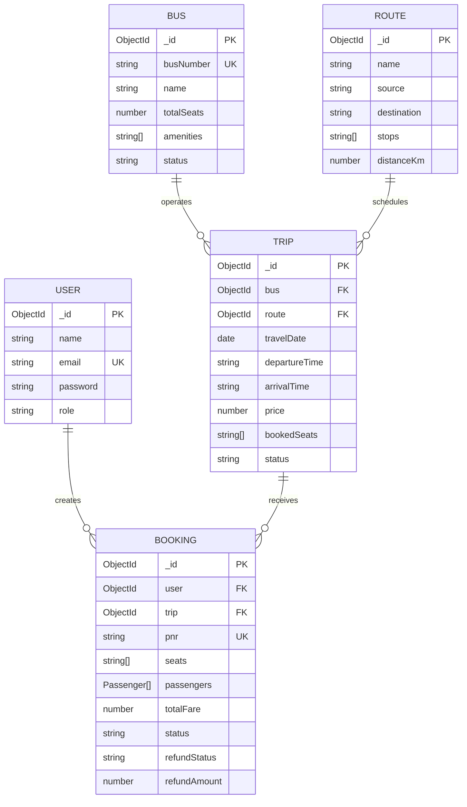

# BusBooker database relationships

`Trip.bookedSeats` is the current seat-availability source. A booking request atomically adds seats only when none of its requested seats are already present. Confirmed bookings are used for manifests and reporting; cancelled bookings remain as history but no longer occupy seats.

